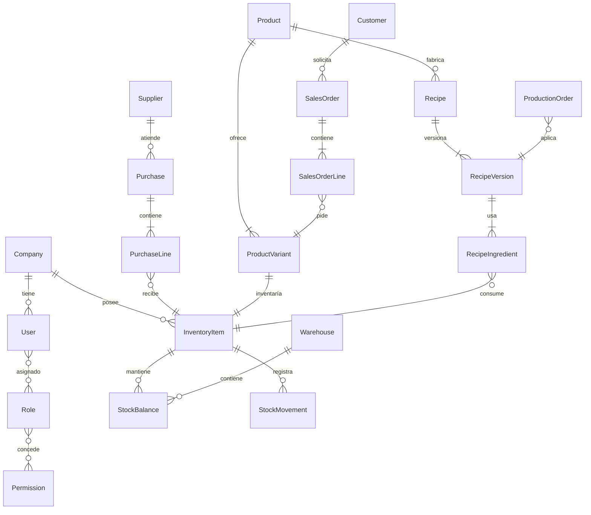

# Modelo de datos y diccionario preliminar

Estado: diseño revisable; no autoriza migraciones.

## ERD de alto nivel

## Convenciones físicas

- UUID en entidades de negocio.
- Propiedades TypeScript `camelCase`; PostgreSQL `snake_case` mediante `@map`.
- `companyId`, `createdAt` y `updatedAt` obligatorios en datos de negocio.
- Decimales de cantidad/costo: `Decimal(18,6)`; totales: `Decimal(18,4)`; porcentajes: `Decimal(7,4)`.
- Relaciones históricas usan `Restrict`; catálogos desactivables no se eliminan físicamente.
- Códigos únicos por empresa.

## Diccionario crítico

| Entidad.campo | Tipo Prisma / PostgreSQL | Regla |
|---|---|---|
| `InventoryItem.code` | `String` / `varchar(30)` | Único por empresa |
| `InventoryItem.baseUnitId` | `String` / `uuid` | Obligatorio |
| `InventoryItem.lotMode` | enum / enum | `NONE`, `OPTIONAL`, `REQUIRED` |
| `StockBalance.onHandQuantity` | `Decimal` / `numeric(18,6)` | `>= 0` |
| `StockBalance.reservedQuantity` | `Decimal` / `numeric(18,6)` | Entre 0 y stock físico |
| `StockBalance.averageUnitCost` | `Decimal` / `numeric(18,6)` | PEN, sin IGV |
| `StockMovement.postingSequence` | `BigInt` / `bigint` | Monótono por empresa |
| `Purchase.code` | `String` / `varchar(24)` | `CMP-YYYY-000001` |
| `Purchase.status` | enum / enum | `DRAFT`, `PENDING`, `APPROVED`, `REJECTED`, `CANCELLED` |
| `PurchaseLine.baseQuantity` | `Decimal` / `numeric(18,6)` | Calculada por servidor |
| `PurchaseLine.netUnitPrice` | `Decimal` / `numeric(18,6)` | Por unidad base |
| `ProductVariant.sku` | `String` / `varchar(60)` | Único por empresa |
| `RecipeVersion.yieldQuantity` | `Decimal` / `numeric(18,6)` | Mayor a cero |
| `RecipeIngredient.quantity` | `Decimal` / `numeric(18,6)` | Mayor a cero |
| `ProductionOrder.plannedQuantity` | `Decimal` / `numeric(18,6)` | Mayor a cero |
| `SalesOrder.status` | enum / enum | Flujo definido en procesos |
| `OutboxEvent.idempotencyKey` | `String` / `varchar(100)` | Único |

## Restricciones a confirmar

- Si una receta pertenece al producto o puede especializarse por variante.
- Qué ítems exigen vencimiento además de lote.
- Autoridad y fuente del tipo de cambio.
- Redondeo de impuestos por línea o documento.
- Si el almacén único del MVP necesita ubicaciones internas.

El `schema.prisma` de ejecución permanecerá sin modelos de negocio hasta aprobar estas decisiones.
